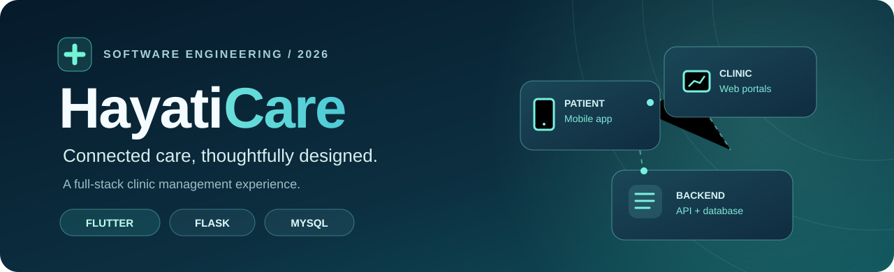
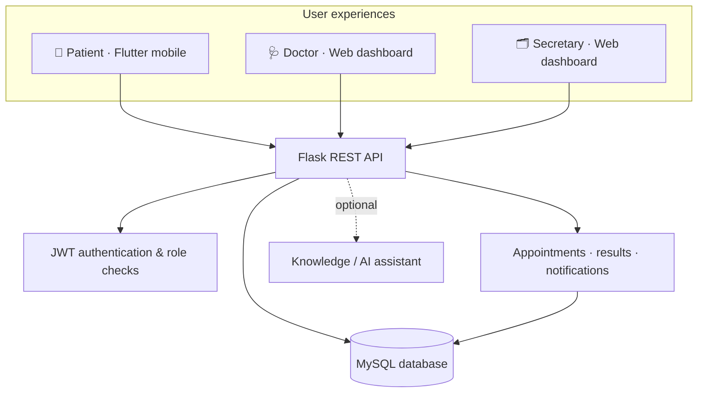

<a id="top"></a>

<div align="center">
  

  <br />

  <strong>A role-based hospital management platform that brings patients, clinicians, and clinic staff into one connected workflow.</strong>

  <br />

  
  
  
  

  <br />

  
  

  <br /><br />

  <a href="#-features"><strong>Explore the features</strong></a> &nbsp;·&nbsp;
  <a href="#-architecture"><strong>System architecture</strong></a> &nbsp;·&nbsp;
  <a href="#-getting-started"><strong>Run locally</strong></a> &nbsp;·&nbsp;
  <a href="#-team--credits"><strong>Meet the team</strong></a>
</div>

---

## ✦ The idea

**Healthcare workflows are more effective when the right information reaches the right person.**

HayatiCare is a full-stack software engineering project exploring how a clinic can manage appointments, patients, test results, and communication through a unified system. It combines a **Flutter patient application**, **web dashboards for medical staff**, and a **Flask REST API backed by MySQL**.

Rather than giving everyone the same interface, HayatiCare organizes the experience around **three distinct roles** and their responsibilities.

<table>
  <tr>
    <th width="33%">📱 Patient</th>
    <th width="33%">🩺 Doctor</th>
    <th width="34%">🗂️ Secretary</th>
  </tr>
  <tr>
    <td>View appointments and results, submit home measurements, receive notifications, and access educational guidance.</td>
    <td>Review assigned patients, appointments, test results, and clinical records in the web dashboard.</td>
    <td>Coordinate appointments, manage patient and doctor accounts, and oversee day-to-day clinic workflows.</td>
  </tr>
</table>

> [!IMPORTANT]
> **Academic demonstration — not a medical device.** HayatiCare is a university project, not a deployed healthcare product. Do not use it with real patient data or for diagnosis, treatment decisions, or clinical emergencies. The AI features provide general educational information only.

## ✨ Features

| Capability | What it enables |
|:--|:--|
| 🔐 **Role-based access** | Separate patient, doctor, and secretary experiences with JWT-based authentication |
| 📆 **Appointment workflows** | Appointment scheduling, viewing, updates, and availability-related operations |
| 👥 **Patient & doctor management** | Structured account and record management through staff workflows |
| 🧪 **Medical test results** | Record, view, and group test results using the backend's relational data model |
| 📊 **Reference-range checks** | Compare supported lab values against configured reference ranges and flag out-of-range results |
| 🔔 **Notifications** | Surface appointment- and results-related updates in the application |
| ❤️ **Body health & home tests** | Patient-oriented health measurements and submission workflows |
| 💬 **Educational AI assistance** | Optional, knowledge-assisted responses about general health topics and app navigation — **not diagnoses** |

<details>
<summary><strong>More about the AI component</strong></summary>

The project includes an optional retrieval/knowledge workflow built with Python, LangChain, ChromaDB, and an AI provider. It uses educational reference content in the `knowledge/` directory. An appropriate API key and supporting configuration may be required to run the AI-backed features.

Responses are intended for general education and application guidance only. They are **not** a substitute for licensed clinical judgment.

</details>

## 🏗 Architecture

The system separates the user-facing applications from the API, domain services, and persistence layer.



### Technology stack

| Layer | Technologies |
|:--|:--|
| **Patient mobile app** | Flutter, Dart, Riverpod, Dio, Flutter Secure Storage |
| **Web portals** | HTML5, CSS3, vanilla JavaScript |
| **Backend** | Python, Flask, Flask-SQLAlchemy, Flask-JWT-Extended, Flask-CORS |
| **Database** | MySQL, SQLAlchemy models, SQL schema |
| **Optional knowledge layer** | LangChain, ChromaDB, OpenAI integration |

## 📂 Repository guide

```text
HayatiCare/
|-- backend/
|   |-- app/
|   |   |-- models/           # Database models
|   |   |-- routes/           # API endpoints
|   |   |-- services/         # Application logic
|   |   `-- utils/            # Shared helpers
|   |-- migrations/schema.sql # Database schema
|   |-- requirements.txt
|   |-- run.py                # Flask entry point
|   `-- seed_data.py          # Disposable demo data only
|
|-- flutter_app/               # Patient-facing Flutter application
|-- web/                       # Doctor and secretary dashboards
|-- android/                   # Earlier native Android prototype
|-- knowledge/                 # Educational reference material
|-- .env.example               # Safe configuration template
`-- README.md
```

> The `android/` folder at the repository root is an **older native Android prototype**. The active Flutter app has its own Android platform files inside `flutter_app/android/`.

## 🚀 Getting started

These instructions are for a **local development demonstration**. They are not production deployment instructions.

### Prerequisites

- **Python 3.10+** and `pip`
- **MySQL 8+**
- **Flutter SDK 3.x** and an Android emulator or connected Android device
- A modern browser to access the staff dashboards

### 1 · Clone the project

```powershell
git clone https://github.com/mhmdalali1/HayatiCare.git
cd HayatiCare
```

### 2 · Prepare the MySQL database

Create an empty `hmss_db` database and a local database user. For example, in the MySQL client, using an administrator account:

```sql
CREATE DATABASE IF NOT EXISTS hmss_db
  CHARACTER SET utf8mb4 COLLATE utf8mb4_unicode_ci;

CREATE USER IF NOT EXISTS 'hmss_user'@'localhost'
  IDENTIFIED BY 'replace_with_a_strong_local_password';

GRANT ALL PRIVILEGES ON hmss_db.* TO 'hmss_user'@'localhost';
```

Then import the provided schema from the project root. On **Windows PowerShell**, you can invoke the CMD shell for input redirection:

```powershell
cmd /c "mysql -u hmss_user -p hmss_db < backend\migrations\schema.sql"
```

Use your own strong local password. Never commit database credentials.

### 3 · Start the Flask backend

From the repository root:

```powershell
python -m venv backend\.venv
.\backend\.venv\Scripts\Activate.ps1
pip install -r backend\requirements.txt
Copy-Item .env.example .env
```

Edit `.env` and replace the example database values. Generate **two different** strong secrets for `SECRET_KEY` and `JWT_SECRET_KEY`:

```powershell
python -c "import secrets; print(secrets.token_hex(32))"
```

Start the local server:

```powershell
python backend\run.py
```

When running, the web dashboard is served at **http://localhost:5000**. Keep the development server on a trusted network.

### 4 · Run the Flutter patient app

Open a **second terminal**:

```powershell
cd flutter_app
flutter pub get
flutter run
```

The default base URL is `http://10.0.2.2:5000`, suitable for a standard Android emulator.

For a **physical Android phone** on the same trusted network as the backend, pass your computer's local IPv4 address:

```powershell
flutter run --dart-define="HAYATICARE_API_BASE_URL=http://YOUR_PC_LAN_IP:5000"
```

The phone must be able to reach the development server. Building the iOS target requires macOS and Xcode.

<details>
<summary><strong>Optional: create disposable demonstration accounts</strong></summary>

The seed scripts are provided only for **isolated development databases with fictional records**. They require explicit environment passwords (minimum 12 characters):

```powershell
$env:DEMO_SEED_PASSWORD="choose_a_unique_demo_password"
python backend\seed_data.py
```

To create the initial secretary account, set `ADMIN_PASSWORD` and run `python backend\seed_admin.py`. Never run these scripts against real user records or a production database.

</details>

## 🧪 Validation

The source has been checked locally with the following tools:

```powershell
# From the repository root: Python syntax verification
python -m compileall -q backend

# From flutter_app/: static analysis and tests
flutter analyze
flutter test
```

At the time of repository preparation, the Python syntax check passed, Flutter analysis reported no errors or warnings (informational lint suggestions remain), and the existing **placeholder** Flutter smoke test passed. **Automated integration tests, full device builds, and real database workflows are not yet verified.**

## 🔒 Security considerations

This is a learning project and needs additional review before any real deployment:

- `.env`, keys, database files, caches, and build artifacts are excluded from the public repository.
- Authentication and role checks are implemented, but their security has **not** been independently audited.
- Development settings, transport security, CORS, secret handling, and clinical-data privacy would require production hardening.
- Use **fictional** patients and non-sensitive sample records for demonstrations and screenshots.
- Any credentials exposed in earlier versions or other repositories must be rotated; a new clean history does not undo past exposure.

## 👥 Team & credits

Built collaboratively as part of **COE461 — Software Engineering**, **Lebanese American University**, Spring 2026.

| Project contributors |
|:--|
| **Mohamad Al Ali** |
| **Mohammad Sinn** |
| **Ahmad Ghaddar** |
| **Omar Saadeh** |

This repository showcases the **team's academic work**. It should not be interpreted as a claim of sole authorship.

## 📄 License

No open-source license is currently provided. All rights remain with their respective owners. Please confirm the project's collective licensing terms and obtain contributor permission before redistributing or reusing the work.

---

<div align="center">
  <strong>HayatiCare</strong><br/>
  <sub>Built to explore a more connected clinic experience — one workflow at a time.</sub><br/><br/>
  <a href="#top">Back to top ↑</a>
</div>
